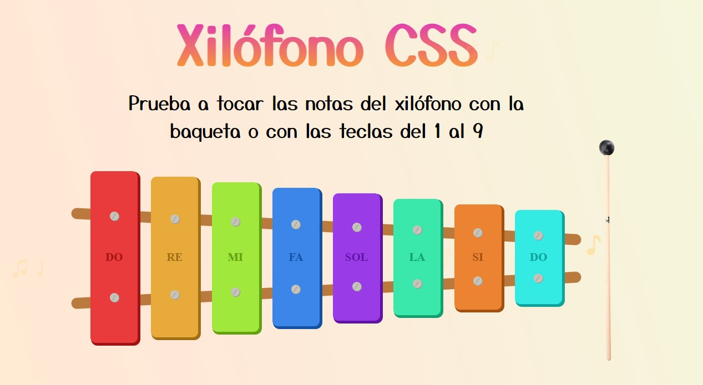

# Xilófono interactivo



Pequeño proyecto interactivo creado con HTML, CSS/SCSS y JavaScript. El xilófono se construye visualmente mediante HTML y estilos, mientras que JavaScript gestiona la reproducción de sonidos y las interacciones que acompañan a cada nota.

La única imagen usada es la de la baqueta; el resto del instrumento se genera por completo con estilos. Además, está bloqueado con media queries para que a partir de 680 px de ancho aparezca un aviso para girar el dispositivo, ya que de lo contrario no se podría apreciar al completo.

## Demo

Puedes verlo en vivo en GitHub Pages: <https://saulry90.github.io/Xilofono/>

## Características

- Interacción con las notas mediante el ratón o al tocar la pantalla.
- Reproducción de las ocho notas musicales con sus sonidos correspondientes, también con las teclas del 1 al 8.
- Animación de la baqueta al interactuar con el instrumento.
- Cursor personalizado que sigue el movimiento del ratón en escritorio.
- Accesible por teclado y respetuoso con la preferencia `prefers-reduced-motion`.
- Aviso para girar el dispositivo en pantallas de hasta 680 px de ancho, para facilitar la visualización del instrumento completo.

## Tecnologías

- HTML5
- CSS3 y SCSS
- JavaScript vanilla

## Cómo probarlo localmente

Clona el repositorio:

```bash
git clone https://github.com/saulry90/Xilofono.git
cd Xilofono
```

Abre `index.html` en un navegador para probar el proyecto. No hace falta instalar dependencias: el sitio funciona directamente con los archivos del repositorio.

## Desarrollo

Los estilos se escriben en `assets/css/app.scss` y se compilan a `assets/css/app.css`. Para regenerarlos tras un cambio:

```bash
npm install
npm run sass        # compilación puntual
npm run sass:watch  # recompilación automática al guardar
```

## Estructura del proyecto

- `index.html`: estructura del instrumento.
- `assets/css/app.scss`: archivo fuente de los estilos SCSS.
- `assets/css/app.css`: estilos compilados que usa la página.
- `assets/js/app.js`: interacciones, reproducción de audio y animaciones.
- `assets/img/`: recursos gráficos.
- `assets/mp3/`: archivos de audio de las notas.

---

⌨️ con ❤️ por [Saúl Roldán](https://www.linkedin.com/in/saul-roldan/) 😊
